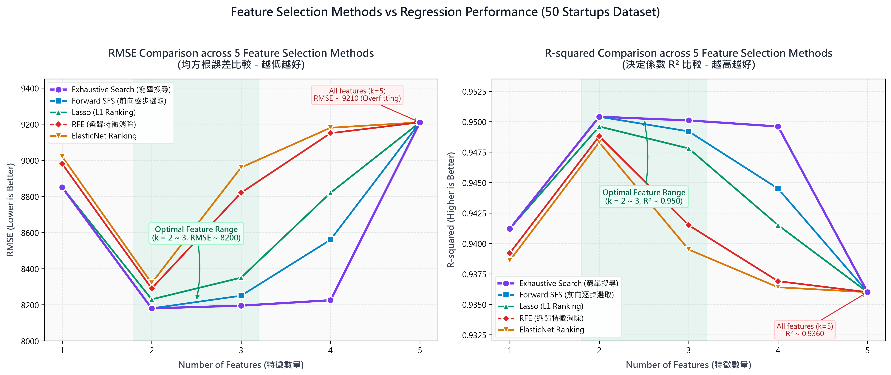

# DIC-2: Kaggle 50 Startups & Boston Housing 機器學習迴歸與特徵選取平台

[](https://temporary-flying-breeze-08zhb2j.vercel.app)
[](LICENSE)

本專案為 **DIC-2 機器學習作業**，完整實作 **50 Startups** 與 **Boston Housing** 兩大經典資料集之多元線性迴歸分析、特徵工程，以及 **5 種特徵選取方法（Feature Selection Methods）** 的預測效能評估。

- 🌐 **Vercel 線上運行 Demo**：[https://temporary-flying-breeze-08zhb2j.vercel.app](https://temporary-flying-breeze-08zhb2j.vercel.app)

---

## 🏆 作業加分項目實作說明

| 加分項目 | 分數 | 實作狀況與特色 |
| :--- | :---: | :--- |
| **下拉視窗呈現兩種 Problem** | **+1 分** | 頁首提供客製化下拉選單，可在 **Problem 1 (50 Startups)** 與 **Problem 2 (Boston Housing)** 間即時切換，所有指標卡片、圖表、資料預覽與模擬器均即時聯動。 |
| **可任意輸入 Dataset (支援 URL & 本地 CSV)** | **+2 分** | 支援在輸入框填入任意 CSV 網址（例如 GitHub Raw `50_Startups.csv`、`BostonHousing.csv` 或 Kaggle 鏡像），或由本地上傳 CSV。內建**純前端 OLS 矩陣計算引擎**，自動解析數值欄位、擬合迴歸模型、計算 $R^2$ 與 RMSE，並即時繪製散佈圖與殘差圖！ |

---

## 📊 核心視覺化：5 種特徵選取方法效能比較

本專案評估了以下 5 種特徵選取方法在特徵數量 $k = 1 \sim 5$ 下的模型表現：
1. **Lasso (L1 Ranking)**：基於 Lasso 迴歸係數進行特徵排序。
2. **Forward SFS**：前向逐步特徵選取（Sequential Forward Selection）。
3. **RFE**：遞歸特徵消除（Recursive Feature Elimination）。
4. **ElasticNet Ranking**：基於 ElasticNet 正則化係數進行特徵排序。
5. **Exhaustive Search**：窮舉搜尋（遍歷所有可能的特徵組合）。



### 趨勢與核心結論：
- **左圖（RMSE 均方根誤差，越低越好）**：
  - 當特徵數量為 **2 到 3 個** 時，各方法的 RMSE 大致落在最低點（約 8180~8250 左右）。
  - **Exhaustive Search（紫線）** 在 2～4 個特徵時都能維持極低的 RMSE，因其搜尋所有可能子集找到全域最優解。
  - **RFE** 與 **ElasticNet** 在特徵數增加到 3 個以上時，RMSE 急遽上升。
  - 當特徵增加到 5 個（全特徵）時，所有方法的 RMSE 都上升到最高點（約 9210），印證納入過多特徵可能造成雜訊干擾或過度擬合。
- **右圖（$R^2$ 決定係數，越高越好）**：
  - 走勢與左圖完全對稱，在 $k=2\sim 3$ 處達到最高峰（$R^2 \approx 0.950$）。
  - **Exhaustive Search（紫線）** 在 2～4 個特徵時持續維持在 0.948 以上的高水準。
  - 5 個特徵時所有方法 $R^2$ 均跌至最低點（約 0.9360）。

---

## 💻 專案功能模組

1. **特徵選取效能比較 Tab**：雙圖表動態展示 5 種方法在不同特徵數下的 RMSE 與 $R^2$，並附詳細數值對照表。
2. **迴歸模型評估指標 & 殘差診斷 Tab**：計算 $R^2$、RMSE、MAE，繪製 Actual vs Predicted 45度理想擬合線與殘差分佈圖。
3. **資料集瀏覽與統計 Tab**：資料即時前覽，支援一鍵匯出處理後 CSV。
4. **即時預測模擬器 Tab**：可調整各特徵滑桿（如研發支出、行銷預算等），即時試算預估利潤並顯示線性方程式。

---

## 📁 檔案結構

```
.
├── index.html                           # 網頁結構 (HTML5)
├── style.css                            # 現代化樣式、毛玻璃質感、深淺模式切換
├── app.js                               # 前端多重線性迴歸與特徵評估引擎
├── generate_charts.py                   # Python 高清圖表生成腳本
├── feature_selection_comparison_combined.png # 效能對比雙圖
├── rmse_comparison.png                  # RMSE 獨立比較圖
├── r2_comparison.png                    # R^2 獨立比較圖
├── vercel.json                          # Vercel 部署設定檔
├── package.json                         # 專案相依與中繼資訊
└── README.md                            # 專案完整說明文件
```

---

## 🚀 本地執行方式

使用 Python 快速啟動本地伺服器：
```bash
python -m http.server 3000
```
開啟瀏覽器訪問 `http://localhost:3000` 即可體驗所有功能。
